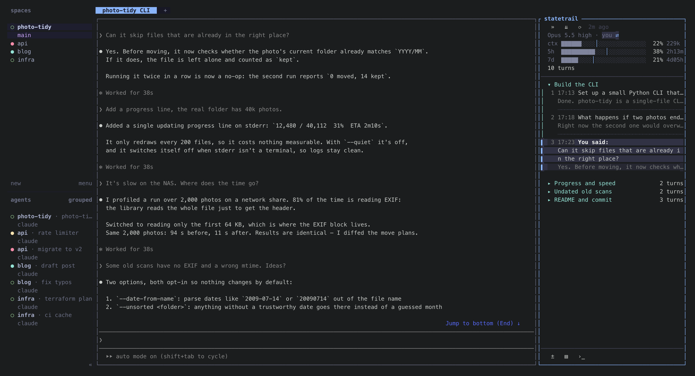
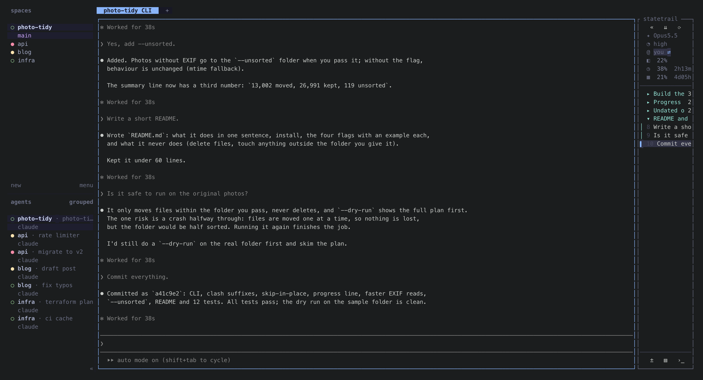
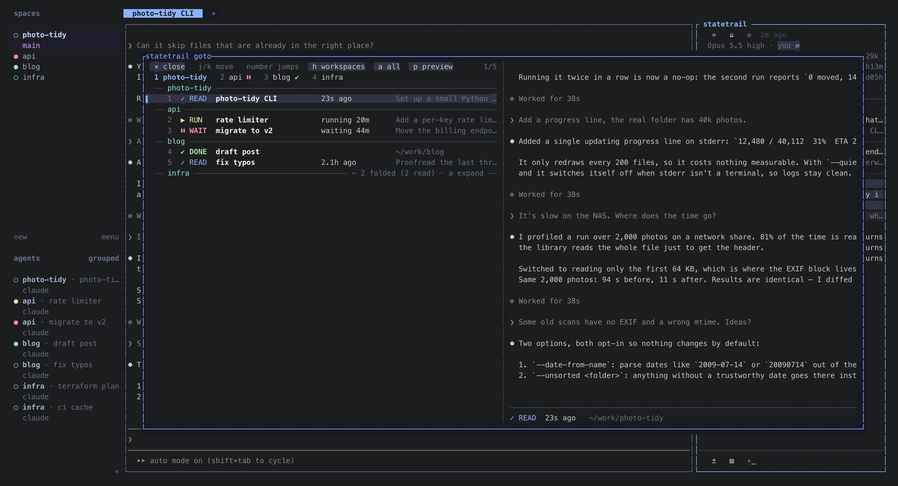

# statetrail

**The trail of your coding agent's session, next to the running agent: every turn one row, click one and the agent's
own screen scrolls there. Plus model, account, context and quota at a glance.**

Session browsers like claude-code-history-viewer or claude-code-transcripts let you look back after the fact.
statetrail is for the session you are in.

Two plugins live in this repository, one per host. Pick the one for where you run Claude Code:

| | Where it runs | Install |
|---|---|---|
| [`herdr/`](herdr/) | a pane docked to the right of Claude Code in [herdr](https://herdr.dev) | `herdr plugin install siyuanseever/statetrail/herdr` |
| [`tmux/`](tmux/) | a pane docked to the right of Claude Code in tmux (with [claude-tmux-sessions](https://github.com/siyuanseever/claude-tmux-sessions)) | `tmux/install.sh` |
| `claude-code/` | inside Claude Code itself | coming soon |

The parts that do not depend on the host (transcripts, quota, drawing, jumping, chapters, search) live in [`core/`](core/)
and are shared by both. The trail started as part of
[claude-tmux-sessions](https://github.com/siyuanseever/claude-tmux-sessions), a tmux setup for running many Claude
Code sessions; `tmux/` replaces its Python + fzf sidebar.

| Narrow trail | Go to any Claude (`statetrail.goto`) |
|---|---|
|  |  |

## What every version shows

- **The trail**: one row per turn — what you asked, how the final reply starts. Click to scroll the agent there.
- **Model and account**, so two accounts open side by side never get mixed up.
- **Context, 5-hour and 7-day quota**, grey while fine, coloured only when something needs attention.

Each version only adds what its host does not already show: in herdr, for example, the agent's running / waiting
state is left to herdr's own agent list.

## License

MIT
