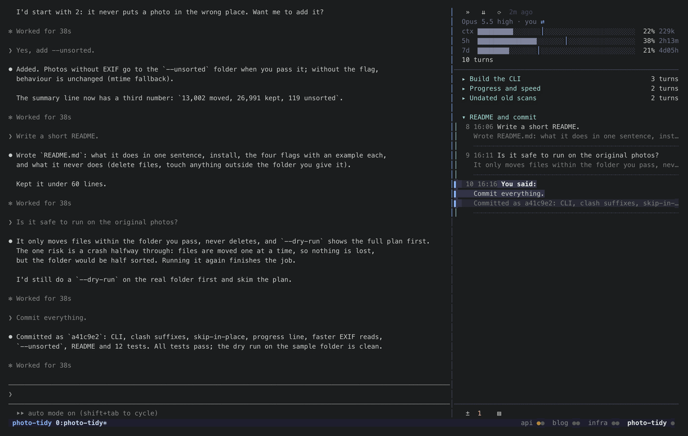
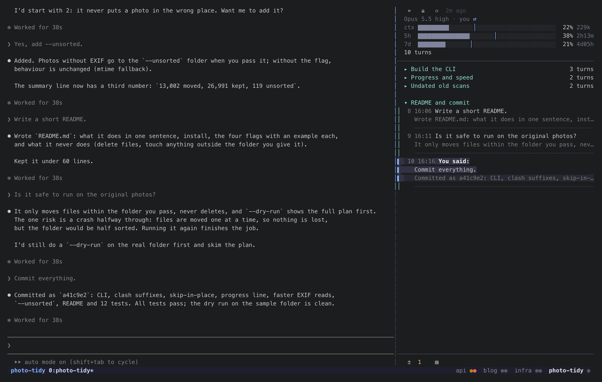
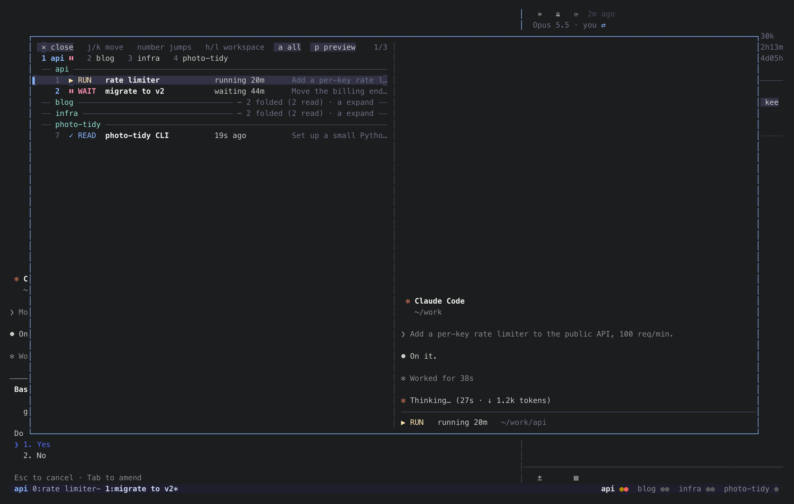
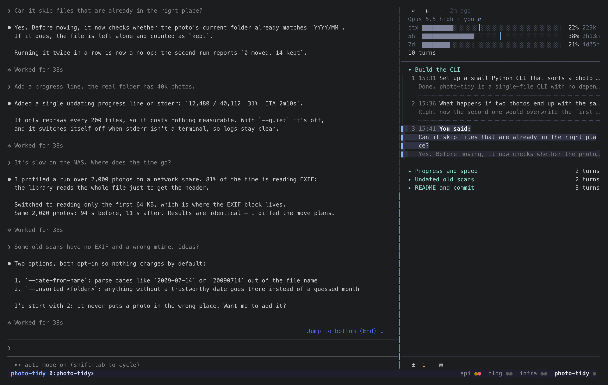

# statetrail

**在 tmux 里一眼看清所有 Claude Code：谁在等你、谁做完了；点一下跳过去，跳到任何一个会话的任何一轮。**

<p align="center">
  
</p>

<p align="center"><sub>真 tmux、真程序；Claude 和它们的数据是演示装置（<a href="tmux/demo/">tmux/demo</a>）。</sub></p>

| 每个 Claude 一个圆点，红的在等你 | `prefix g`：按 session 列出所有 Claude | 点一轮：Claude 滚到那里 |
|---|---|---|
|  |  |  |

[English](README.md)

## 有什么

- **状态栏上每个 Claude 一个圆点**，按 tmux session 分组：红的在等你（权限框、选择题），绿的是你不在时做完了，
  暗金在跑，灰的你看过了。点圆点跳过去，点 session 名切过去。
- **`prefix g`**：浮窗按 session 列出所有 Claude，写着这个状态多久了、开场让它做什么，右边是实时画面。
  `h` `l` 换 session，`j` `k` 在 Claude 之间挪，`Enter` 跳过去。
- **轨迹**：贴在你正看着的 Claude 右边，一轮一行（你说了什么、回复怎么开头），按任务分章；点一轮，Claude 自己的屏幕
  滚到那里。`/` 搜这个会话，`Tab` 搜本机所有会话。表头是模型、账号、上下文和 5 小时 / 7 天额度。

状态靠读每个窗格的屏幕认（规则用的是 [herdr](https://herdr.dev) 的 Claude 识别规则），再加上 Claude Code 自己写的
会话文件。不用钩子，不改 `~/.claude/settings.json`。一个 Rust 小程序：常驻部分约 15 MB 内存，每个开着的轨迹约 10 MB；
只有窗口有了新输出才去读那个 Claude 的屏幕（另外每 30 秒补读一次）。

## 安装

macOS 或 Linux，tmux 3.2+（点圆点要 3.4+，Git、文件浮窗要 3.7+）。

```bash
curl -fsSL https://raw.githubusercontent.com/siyuanseever/statetrail/main/tmux/get.sh | sh
```

再在 tmux 配置最后加一行，重新加载 tmux：

```tmux
run-shell '~/.local/bin/statetrail-tmux init'
```

点一轮让 Claude 跳过去，要用 Claude Code 的全屏界面（`/tui fullscreen`）。配置、按键、怎么做的：
[tmux/README.zh-CN.md](tmux/README.zh-CN.md)。

## herdr 也有

同样的轨迹和浮窗，做成了 [herdr](https://herdr.dev) 插件：`herdr plugin install siyuanseever/statetrail/herdr`，见 [herdr/](herdr/)。

## 目录

| | |
|---|---|
| [`tmux/`](tmux/) | tmux 版 |
| [`herdr/`](herdr/) | herdr 插件 |
| [`core/`](core/) | 两边共用：读对话记录、额度、画面、跳转、分章、搜索、跳转浮窗、看屏幕认状态 |

## 致谢

认状态的规则（`core/src/detect/claude.toml`）和匹配办法来自 [herdr](https://github.com/herdrdev/herdr)，
Apache License 2.0，许可证原文放在规则旁边。

## 许可

MIT
