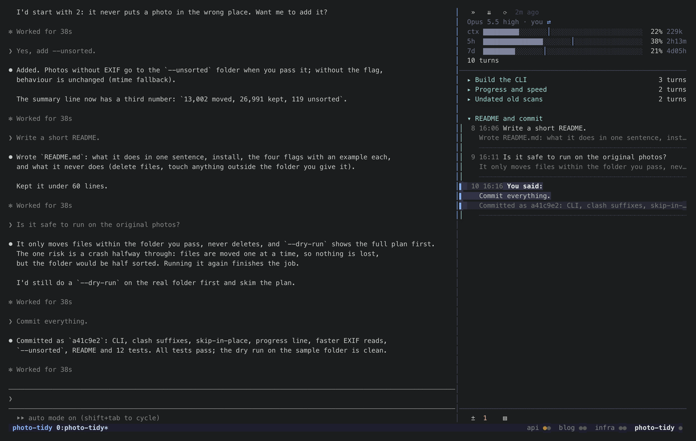
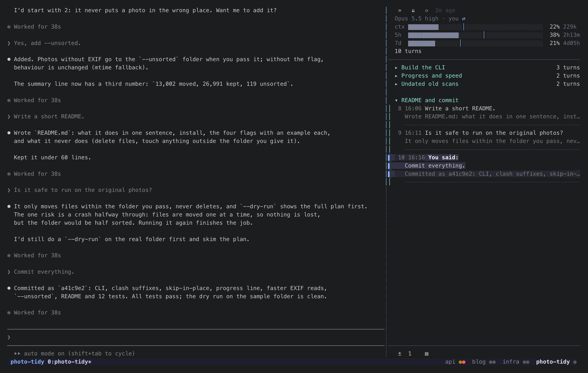
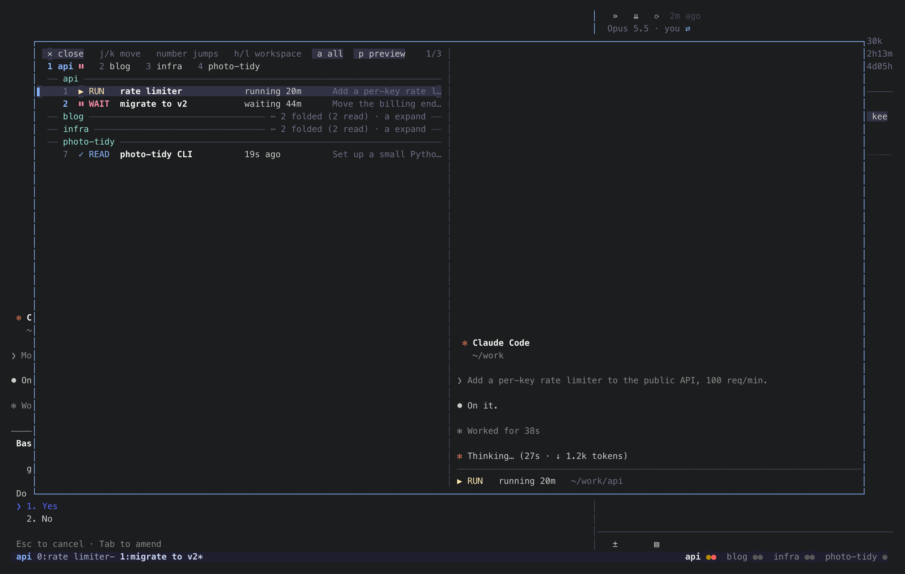

# statetrail for tmux：推广稿（草稿，发之前逐条给你看原文、你说「发」才发）

每条下面嵌着发的时候配的图（就是仓库里的 `tmux/docs/` 那几张），看到的就是发出去的样子。
链接一律用 https://github.com/siyuanseever/statetrail 。

---

## 1. Reddit r/ClaudeAI

**单独发帖两次都没成**（2026-11-09）：第 1 版被 modbot 拦（没写怎么用 Claude 做的，链接 1xrn648）；第 2 版补上后被 Reddit 全站过滤删掉
（新账号 karma 低、当时邮箱没验证；r/ClaudeAI 现在要 karma ≥ 50 才能单独发帖）。用户随后验证了邮箱。
**改发在每周展示帖里的评论（成功，带动图）**：r/ClaudeAI「Show us what you've created with Claude!」（11-04 那期，Built with Claude），
评论正文 = 标题一行 + 第 2 版纯文本（去掉 Markdown）。先误发在一个 3 个月前的故障 Megathread 里，已删。
同一期里的同类项目：Qosmopol（所有 Claude Code 会话画成星图，等你的红色闪烁，读本地会话文件，桌面应用/浏览器里）、
Apiarius、Mirador、Smif、muster。我们的区别：长在 tmux 里、轨迹点一轮跳过去、跨会话搜你说过的话。
发的时候的基线：stars=0 forks=0 watchers=0 views14d=30/11 tmux-v0.1.0 downloads=14。一两天后对比 star、访问、来源、下载。

**标题**：statetrail: status-bar dots for every Claude Code session in tmux (which one is blocked, done, running)

**配图**：动图



**正文**（第 2 版：第 1 版被版规机器人拦下，说没写怎么用 Claude 做的；这版补上，写明免费和怎么试）：

I built statetrail because I run many Claude Code sessions across tmux sessions and needed to see which ones are blocked on me. It adds:

- **A dot per Claude in the tmux status bar**, grouped by session. Red is waiting for you (permission prompt, question), green finished while you were elsewhere, gold is running, grey you've seen. Click a dot to jump there.
- **`prefix g`** opens a popup with every Claude by session: how long it's been in that state, what it was asked, and a live preview.
- **A trail** docked next to the Claude you're looking at: one row per turn, grouped into chapters. Click a turn and Claude's own screen scrolls to it.
- **Search what you said**: `/` in the trail filters this session, `Tab` searches every session on the machine, grouped by session; Enter jumps there.

**How Claude Code built it:** the whole thing was written with Claude Code over about two weeks (all 175 commits, ~8.9k lines of Rust). I described what I wanted and used it daily; Claude Code wrote the code, ported herdr's screen-detection rules (Apache-2.0, credited), built the demo rig that records the GIF from a fake Claude in a private tmux server, and tested installs in an Ubuntu container. When a dot showed the wrong state in my own tmux, I'd tell it what I saw and it would find the cause in the pane's screen or Claude's session files.

**Free and open source (MIT).** To try it:

```
curl -fsSL https://raw.githubusercontent.com/siyuanseever/statetrail/main/tmux/get.sh | sh
```

then add `run-shell '~/.local/bin/statetrail-tmux init'` at the end of your tmux.conf. No hooks, nothing added to `settings.json`. macOS and Linux, tmux 3.2+.

https://github.com/siyuanseever/statetrail

---

## 2. Reddit r/tmux

**标题**：Status bar dots for every Claude Code session (click to jump), plus a per-session turn sidebar

**配图**：状态栏圆点 + 轨迹



**正文**：

If you run coding agents in tmux: this puts one dot per Claude Code instance into your status bar, coloured by state
(waiting for you / done / running / seen), grouped by session. Clicking a dot switches the client to that pane,
clicking a session name switches session. `prefix g` lists them all in a `display-popup`.

The tmux side: user ranges in the status line (`#[range=user|…]`, needs tmux 3.4+ for the clicks), one global option
(`@claude_dots`) the background process rewrites when something changes, so the bar updates without waiting for
`status-interval`. One `tmux` call per second; a pane's screen is only captured when its window has new output.
`run-shell 'statetrail-tmux init'` at the end of tmux.conf sets it all up and leaves bindings you've customised alone.

https://github.com/siyuanseever/statetrail

---

## 3. Show HN

**没发成**（2026-11-09）：标题第一版 87 字符超了 80 的上限；换成用户选的第 2 个短标题再提交，跳到 news.ycombinator.com/showlim：
HN 暂时限制新用户发 Show HN（「We're temporarily restricting Show HNs because of a massive influx, mostly by users who aren't yet familiar with the site」），要先在站里正常参与一段时间。没有去掉 Show HN 前缀绕开它。

**标题**：Show HN: Statetrail – See which Claude Code session needs you, from the tmux status bar

**链接**：https://github.com/siyuanseever/statetrail （HN 不能贴图，点进去看到的是仓库首页，首页第一屏就是这张动图）


**第一条评论（自己发）**：

I run a lot of Claude Code sessions in tmux and the hard part stopped being the agents and became noticing which one
is blocked on me. statetrail puts a coloured dot per Claude in the status bar (red = waiting for you), a popup listing
all of them, and a sidebar with the session's turns where clicking a turn scrolls Claude to it.

How it knows the state: it reads each pane's screen with the Claude detection rules from herdr (Apache-2.0, credited
in the repo), and combines that with the session files Claude Code itself writes (busy/idle). No hooks. Rust,
macOS and Linux, tmux 3.2+. It was built with Claude Code.

The things I'm least sure about: the "done but you haven't looked" state relies on tmux client focus, and long-lived
background shells are deliberately not counted as running. Happy to hear where that's wrong for you.

---

## 4. awesome-claude-code（提 PR / 按它的投稿方式）

先看它现在的投稿规则再提。条目一行：

- [statetrail](https://github.com/siyuanseever/statetrail) – tmux status-bar dots for every Claude Code session
  (waiting / done / running), a popup to jump between them, and a per-session turn sidebar. No hooks.

---

## 5. herdr Discord / 讨论区（statetrail 帖子下面回一条）

**已发**（2026-11-09，GitHub 讨论区 #5758 下的评论）：https://github.com/herdrdev/herdr/discussions/5758#discussioncomment-19488399

**配图**：跳转浮窗



statetrail now has a tmux version too: the same trail and goto popup, plus a dot per Claude in the tmux status bar.
State detection reuses herdr's Claude rules (credited, Apache-2.0). https://github.com/siyuanseever/statetrail

---

## 6. V2EX（分享创造）

**没发成**（2026-11-09）：账号要邀请码激活才能发帖（发帖页跳到「使用邀请码激活账号」）。

**标题**：statetrail：在 tmux 状态栏上看每个 Claude Code 会话在等你、做完还是在跑（开源）

**配图**：动图


**正文**：

我在 tmux 里同时开很多个 Claude Code，需要一眼看出哪个卡在权限框上等我、哪个已经做完。statetrail 做了这几件事：

- tmux 状态栏上每个 Claude 一个圆点，按 session 分组：红的在等你，绿的做完了你还没看，黄的在跑，灰的看过了。点圆点直接跳过去。
- `prefix g` 弹一个浮窗，按 session 列出所有 Claude：这个状态多久了、开场让它干什么、右边是实时画面。
- 每个 Claude 旁边一条「轨迹」：一轮一行，按任务分章，点哪一轮 Claude 就滚到哪一轮。
- 搜你说过的话：轨迹里按 `/` 搜这个会话，再按 `Tab` 搜本机所有会话，结果按会话分组，回车直接跳过去（没开的会新开窗口接着聊）。

状态是看每个窗格的屏幕认的（用的是 herdr 的识别规则），再加上 Claude Code 自己写的会话文件，不用装钩子、不改 settings.json。
Rust 写的单个程序，用 Claude Code 写的，macOS / Linux，一行 curl 装好，tmux.conf 加一行。

https://github.com/siyuanseever/statetrail

欢迎试用，状态认错了的情况特别想知道。

---

## 7. 知乎（专栏文章）

**已发**（2026-11-09，个人号「三日猫」，话题 tmux、claude-code，封面是状态栏截图）：https://zhuanlan.zhihu.com/p/2103176707616273166
10-24 那篇旧文章（https://zhuanlan.zhihu.com/p/2097361811792204776）开头加了一句「更新（2026-11-09）：……介绍见新文章」，两篇都留着（用户定的，不合并）。

正式的工具分享，接着 10-24 那篇 claude-tmux-sessions 写：见 [zhihu.md](zhihu.md)。
