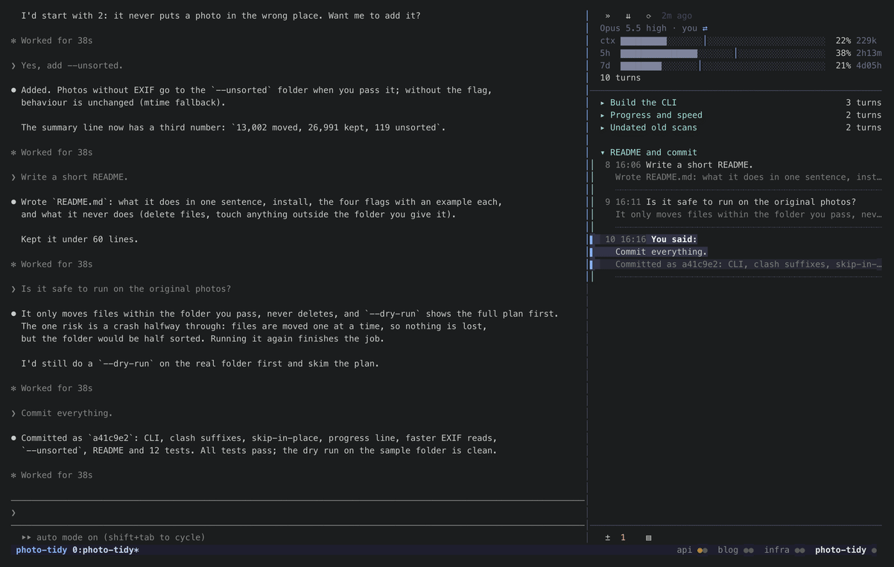
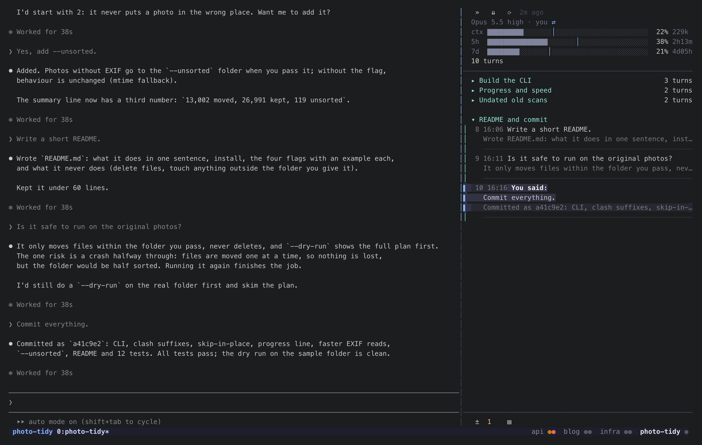
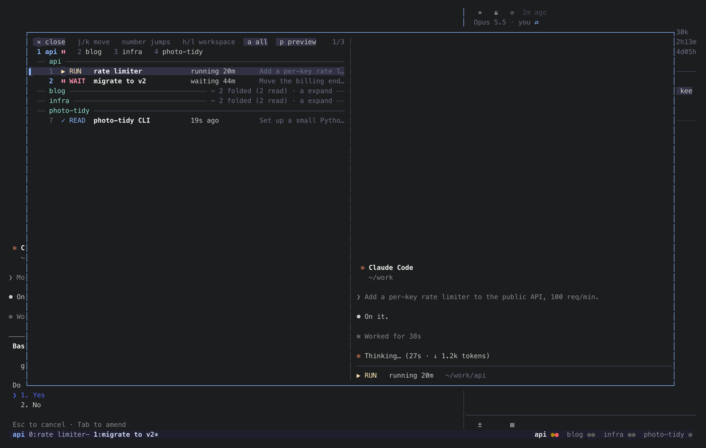
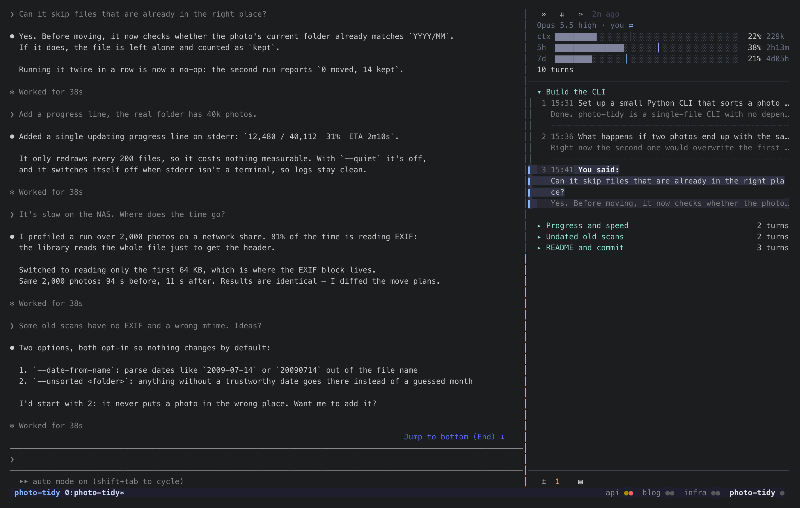
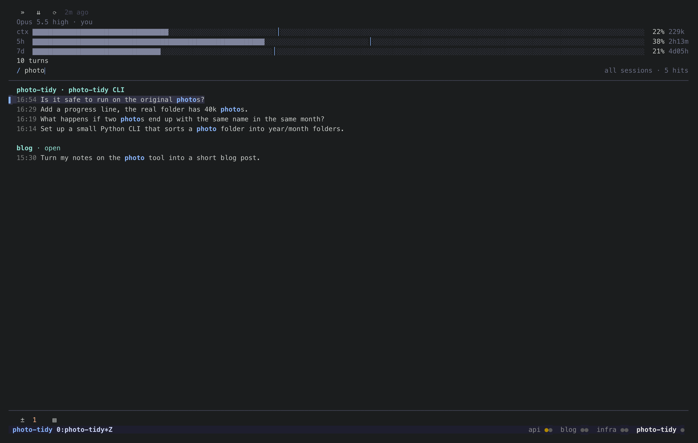

# statetrail：在 tmux 里管理多个 Claude Code 会话的开源工具

> 发布前删掉这一段。图都在仓库 `tmux/docs/` 下，全部是演示数据、真程序画的（`tmux/demo/gif.py` 生成）。
> 知乎题图用 `statusbar-trail.png`。这篇接着 10-24 那篇（claude-tmux-sessions），讲的是它的下一版。



statetrail 是一个跑在 tmux 里的开源小工具，用来同时管理多个 Claude Code 会话，代码在
[github.com/siyuanseever/statetrail](https://github.com/siyuanseever/statetrail)。它回答三个问题：
**哪个会话在等我、每个会话进行到哪了、这一个会话之前都做过什么。**

## 适合什么样的用法

我平时在 tmux 里同时开着二十个左右的 Claude Code 会话：按项目分 tmux session，一个会话负责一摊事，
我只在有会话需要我确认、或者做完了要我看结果的时候过去。这种用法下，瓶颈不在 Claude，而在人：
权限框弹出来没人看到，会话就一直干等；做完的结果没人看，就一直放着。

tmux 本身只管窗口，不知道窗口里的 Claude 处在什么状态。statetrail 补的就是这一块。

## 三样东西

### 状态栏：每个 Claude 一个圆点



状态栏上，每个 Claude 一个圆点，按 tmux session 分组，颜色表示状态：

- **红**：在等你，权限框或者选择题弹着；
- **绿**：做完了，你还没看；
- **暗金**：正在跑；
- **灰**：做完了，你也看过了。

点圆点直接跳到那个 Claude，点 session 名切到那个 session。状态一变，圆点马上跟着变，不等状态栏的定时刷新。

### 跳转浮窗：所有会话一屏看完



`prefix g` 弹出浮窗，按 session 列出所有 Claude：当前状态、这个状态持续了多久、开场让它做什么，
右边是选中那个会话的实时画面。看过的、闲着的默认收起，列表里只留需要处理的。
`h` `l` 切 session，`j` `k` 在会话之间移动，数字直接跳，`Enter` 过去。

### 轨迹：这一个会话做过的每一轮



每个 Claude 右边贴一条轨迹：一轮一行，写着你说了什么、它的回复怎么开头，按任务自动分章（章名由 Haiku 起）。
点哪一轮，Claude 自己的界面就滚到哪一轮的回复。表头是模型、账号、上下文和 5 小时、7 天额度。

### 搜索：所有会话里你说过的话



在轨迹里按 `/`，打字只留下这个会话里含这些字的轮次；再按 `Tab`，搜本机所有会话里你说过的话，结果按会话分组。
选中一条按 `Enter`：会话开着就切过去并跳到那一轮，没开就新开一个窗口 `claude --resume` 接着用。
想找「上周哪个会话里讨论过某件事」时，比翻历史记录快得多。

## 状态是怎么判断的

上一版靠 Claude Code 的 hooks 上报状态，问题是漏报一次就一直错，而且有些状态（比如弹出的选择题）hooks 根本不报。
这一版改成两个来源：

1. **读屏幕。** 每个窗格的画面按一套规则判断：在跑、等确认、闲着。规则来自开源终端复用器
   [herdr](https://github.com/herdrdev/herdr)（Apache-2.0，仓库里保留了许可证并注明出处），覆盖了各种权限框、表单和后台任务的提示。
2. **Claude Code 自己写的会话文件。** 里面有会话 id、所在的 tmux 窗格、是否在忙，用来认「哪个窗格是哪个会话」，
   以及主回合结束后后台仍在工作的情况。

为了不浪费资源，只有窗口有了新输出才去读那个窗格的屏幕，闲着的会话基本不读。常驻部分约 15 MB 内存。

## 安装

```bash
curl -fsSL https://raw.githubusercontent.com/siyuanseever/statetrail/main/tmux/get.sh | sh
```

然后在 tmux 配置最后加一行，重新加载：

```tmux
run-shell '~/.local/bin/statetrail-tmux init'
```

不需要装 hooks，也不改 `~/.claude/settings.json`。

## 限制

- 需要 tmux 3.2 以上；点状态栏圆点需要 3.4，Git、文件浮窗需要 3.7。
- 点一轮让 Claude 滚过去，依赖 Claude Code 的全屏界面（`/tui fullscreen`）。
- 状态判断依赖 Claude Code 的界面文字，它改版时规则可能要跟着更新。
- 日常在 macOS 上使用；Linux 只在容器里验证过安装和基本功能。

问题和建议欢迎在 GitHub 提 issue，尤其是状态判断错的情况。
