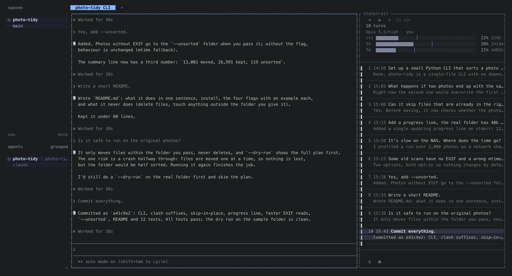

# statetrail

**Claude Code 会话的每一轮，贴在正在运行的 Claude 旁边：点一轮，Claude 就滚到那一轮。**

[herdr](https://herdr.dev) 插件。停在 Claude Code 窗格右边，按轮次列出这个会话：你问了什么，Claude 最终回复的开头。
点一轮，Claude 自己的屏幕就滚到那一轮的最终回复。上面是模型、账号，以及上下文、5 小时、7 天三条额度柱子。

[English](README.md)



claude-code-history-viewer、claude-code-transcripts 这类工具是事后翻看会话的。
statetrail 管的是你正在用的这个会话：贴在运行中的 Claude 旁边，跟着它走。

## 有什么

- **轨迹。** 每轮一行，点一行 Claude 就跳过去，通常不到一秒。滚轮、`↑` `↓`（或 `k` `j`）、PageUp / PageDown、Home / End
  一轮一轮挪选中（列表跟着走），`Enter` 让 Claude 跳到选中的那一轮，`Esc` 关菜单或把焦点还给 Claude。`/compact` 之前的轮次收成一行。
  Claude 一开始干活、一停下，列表就刷新。Claude 退出后轨迹几秒内就关掉（Claude 的窗格整个关掉时立刻关），再启动 Claude 又会自动打开。列表比窗格长时，列表上面那一行的最前面写「▲ 12」、
  下面那一行的最前面写「▼ 5」，是上下还有几轮没露出来（窄版的「▲12」单独占表头最后一行，「▼5」在底部），点一下翻一屏。
  它们靠左，和柱子对齐；翻到头时那段位置空着不收，翻页时旁边的字和按钮不挪。
- **跟着你在 Claude 里看到哪儿。** 在 Claude 自己的屏幕里往上翻，轨迹就标出你正在看的那一轮（列表也翻过去）；回到最底就标最新一轮。
  只有你正在用的那个 Claude 旁边的轨迹这样做，每秒读两次 Claude 的屏幕（约占单核 0.1%），别的轨迹照旧睡着。
- **分章。** 轮次按任务分章：每个新需求、新问题开一章，带一个短章名，这一章的轮次列在下面。  只展开选中的那一轮所在的章，别的章各占一行、最右边写收了几轮；挪到别的章，那一章展开、原来那章收起。
  按 `←`（或 `h`）全部收起，滚轮和 `↑` `↓` 就在章之间挪；按 `→`、`l` 或 `Enter` 展开选中的章、选中它的第一轮。
  点收着的章名也一样，点展开着的章名就收起。哪一轮开新章由 Claude Haiku 读你说的话判断（只判断你正在看的那个 Claude，每句话判断一次，80 句约 0.002 美元）。
  分错了就在一轮上右键「这里开新章」、在章名上右键「并回上一章」，你标的优先。`chapters = "manual"` 只按你标的分，`"off"` 照旧平铺。
- **模型、账号、额度。** `ctx`、`5h`、`7d` 三条柱子，平时灰色，快出问题了才上色：额度柱子按「用得比时间走得快多少」变橙、变红，
  不是单看用了多少。每个额度后面写着还有多久重置（`2h41m`、`2d12h`）。两个 Claude 账号同时在线（各用一个 `CLAUDE_CONFIG_DIR`）
  也没问题，每个窗格显示自己那个账号的。模型和 effort 只显示、不能点：要换就在 Claude 里照常敲 `/model`。
- **就地换账号**（可选）。在 `~/.config/claude-tmux/accounts.json` 里列出你的账号
  （`{"accounts": {"work": {"config_dir": "~/.claude-work"}, ...}}`）后，点账号名（`⇄`）选另一个：那个 Claude 空闲时，
  statetrail 让它退出，再在原窗格里用另一个账号 `--resume` 同一个会话。Claude 在干活、在等你确认、输入框里有没发出去的字时不动。
- **窄版和宽版。** 默认打开窄版（17 列）：模型、effort、账号、带重置时间的百分比、每轮一短行。拖分隔线到 30 列以上就是带柱子的完整宽版。
  左上角的 `»` / `«` 一键在两种宽度之间切换。没有关闭按钮，窄版就是把它收起来的方式。
- **跟着 herdr，只补它没有的。** 颜色取自你的 herdr 主题；没起过名的 tab 会用 Claude 的会话名命名。
  Claude 在不在干活这类状态不重复显示，herdr 左侧的 Agents 栏已经有了。
- **自己的按钮。** 最底下一行放你自己的工具，默认是 Git（lazygit）、文件（yazi）和命令行。工具开在 Claude 下面、目录是 Claude 的
  （Git 和文件占 Claude 那一格高度的 90%，命令行占一半）：
  Claude 宽度不变、只是变矮，旁边的轨迹照样能点，底部栏不变。
  关掉它：再点一次同一个按钮、在工具里退出（lazygit 和 yazi 按 `q`，lazygit 按 `Esc` 也行，命令行输入 `exit`），
  Git 和文件点外面任何地方也会关。关掉后 Claude 恢复原来的高度、拿回焦点。开着一个时点另一个按钮就换过去，同时只开一个。
  第三个默认按钮 `›_` 是命令行，放 Claude 替你跑不了的命令（要输密码的 `sudo`、要在浏览器里登录的 `gcloud auth login`、
  交互式的 `ssh`）：起始目录是 Claude 的，点别处不关。Claude 的目录不在 git 仓库里时（比如 `~/projects`），点 Git 先列出
  下面一两层里的仓库，一行一个，后面是当前分支，有没提交的改动就加个 `●`；点一个就在那里开 lazygit，`Esc` 退出。下面只有一个
  仓库就直接开它；一个都没有就只提示一句，不让 lazygit 问你要不要在这里新建仓库。
- **装了的其他 herdr 插件，一点就开。** 底部在自己的按钮后面用 `│` 隔开，自动列出你装了、开着的其他 herdr 插件，
  每个一个图标，不写字（窄版放在第二行）。herdr 插件自己不带图标，认识的几个由 statetrail 配好（herdr-sidebar `▥`、herdr-file-viewer `▭`、
  zoetrope `⋔`，有 Nerd Font 时用它的图标）；不认识的插件不上第一层，在 `⋯` 里按名字列出，配置里给它写个 `icon` 就会上来。按钮运行这个插件在这台机器上能用的
  第一个 action，顺序按它自己的 manifest（herdr-sidebar 是 `open-sidebar`）。例外是 zoetrope：它的第一个 action 开的是 overlay，
  而 herdr 的 overlay 会盖满整个标签页、连轨迹一起盖住，所以它的按钮改跑 `open-tab`（`open-split` 会把 Claude 从 83 列挤到 42 列；
  新开一个标签页，这一页一点不动）。开新标签页的插件：点按钮会切到它开的那一页，并为这个 Claude 记下来，再点就直接切回那一页，
  不会再开第二个（那一页被你关了才重新开）。放不下的收进 `⋯`，点了在它正上方弹一个小菜单，一个插件一行、只写名字，点哪个就运行哪个，点轨迹里别处收起。
  插件列表在打开轨迹时、点 `⟳` 时、herdr 的 `plugins.json` 改了时（装、卸插件）读：卸掉的插件几秒内自己从底部消失。
- **自己跟着更新。** `herdr plugin update` 之后，开着的轨迹十秒左右就会发现，在原来那一格里换成新代码重启，位置和宽度都不变，
  不用关了再开。

## 安装

需要：macOS 或 Linux 上的 herdr 0.9.5+，别的都不用装：安装时会从本仓库的 GitHub Release 下载你这个平台编好的程序
（Apple 芯片 / Intel 的 Mac，x86_64 / arm64 的 Linux），并校验 SHA-256。别的平台或者断网时，本机有 `cargo` 就现编一个。
可选：lazygit、yazi（默认的两个按钮用）。

```bash
herdr plugin install siyuanseever/statetrail/herdr
brew install lazygit yazi        # 要默认按钮的话
```

Python 版（0.1.x）还在：`herdr plugin install siyuanseever/statetrail/herdr --ref v0.1.4`。

缺了什么，statetrail 会说出来（herdr 通知，或者在它的窗格里写出来），不会静默失败。

然后开一个有 Claude Code 的 tab，轨迹会自己在右边打开。想用快捷键切换，在 `~/.config/herdr/config.toml` 里绑上动作，
再执行 `herdr server reload-config`：

```toml
[[keys.command]]
key = "prefix+t"
type = "plugin_action"
command = "statetrail.toggle"
description = "statetrail：打开，或在宽版 / 窄版之间切换"
```

Claude Code 要用全屏界面（`/tui fullscreen`），跳转滚的就是它。

## 配置

`herdr plugin config-dir statetrail` 打印的目录下的 `config.toml`。每一项都可以不写；文件不存在或写错了就用默认值。

```toml
auto_open = true          # tab 里正好有一个 Claude 时自己打开
default_mode = "narrow"   # 打开时多宽："narrow" 或 "wide"
width = 0.25              # 宽版占 Claude 那一格的比例（总会给 Claude 留 110 列）
icons = "auto"            # "auto"：装了 Nerd Font 就用它的图标，没装用普通符号；也可以写 "nerd" / "unicode" / "text"
                          # 装了不代表终端在用它：显示成方块就手动设 "unicode"
live_usage = true         # 用你的 Claude 登录实时查额度（见下）；false：从不
lang = ""                 # "en" / "zh"；不写就按系统 locale
tab_names = true          # 没起过名的 tab 用 Claude 的会话名命名
chapters = "auto"         # 轮次分章："auto"（Claude Haiku 判断，右键可改）/ "manual"（只按你右键标的）/ "off"（平铺，什么都不发）
tool_height = 0.5         # 底部按钮开的工具占 Claude 那一格高度的比例（0.1–0.9），按钮自己写了 height 就按按钮的

# 最底下一行的按钮。写了 [[buttons]] 就整组替换默认的三个。
# 有图标就只画图标，没有图标（或 icons = "text"）就只写 label。
[[buttons]]
label = "Git"
command = "lazygit"       # 开在 Claude 下面，目录是 Claude 那一格的（经 sh -c）
icon = "git"              # 图标名（git、files）或者直接写一个字形
height = 0.9              # 占 Claude 那一格高度的比例，0.9 是 herdr 允许的最大值
pick_repo = true          # 不在仓库里时，先在下面的仓库里选一个

[[buttons]]
label = "文件"
command = "yazi"
icon = "files"
height = 0.9

[[buttons]]
label = "命令行"
command = "$SHELL"        # 你的登录 shell
icon = "shell"
close_on_blur = false     # 点别处不关；exit，或再点一次按钮才关

# 按钮也可以不跑命令，改成调别的 herdr 插件的动作：
# [[buttons]]
# label = "左栏"
# action = "herdr-sidebar.open-sidebar"

# 其他 herdr 插件的按钮（自动列出）。false：不列
plugin_buttons = true
# 按插件 id（herdr plugin list 里看）单独设：藏掉、换绑它的别的 action、换图标、换名字
# [plugins."herdr-sidebar"]
# action = "show-explorer"
# icon = "◧"
# label = "左栏"
# [plugins."herdr-file-viewer"]
# hidden = true
```

## 读什么、动什么

- **读** Claude Code 的对话记录（`<配置目录>/projects/*/<会话>.jsonl`）和 `.claude.json`（取账号名）。从不写它们。
- **额度：几份来源，谁新用谁。** 每一份都是有才用：
  1. **实时查询**（默认打开，`live_usage = false` 关掉）：调 Claude Code 的 `/usage` 也在调的接口（`api.anthropic.com/api/oauth/usage`），
     最多 30 分钟一次，用 Claude Code 存在 macOS 钥匙串（或 `<配置目录>/.credentials.json`）里的 OAuth 令牌。令牌只在这一次请求里
     放在内存中，从不写下来、不打印、不刷新。这个接口不是公开文档里的 API，变了的话这一份就安静地没有了。
  2. **Status Line 桥接**（你接上了才有，见下）：Claude Code 每回复一条，就把 5 小时、7 天的百分比交给状态栏（Pro / Max 订阅）。不碰任何凭据。
  3. **Claude Code 自己的缓存**：`.claude.json` 里的 `cachedUsageUtilization`，每个配置目录一份。总是有，但 Claude Code 只在它自己去查用量时
     （比如你跑 `/usage`）才更新，可能是好几天前的。

  表头会写出数字有多旧；重置时间已经过了的窗口显示「?」，不显示旧数字。
- **分章会把你说的话发给 Claude Haiku**（`chapters = "auto"`，默认）：用那个 Claude 会话自己的账号跑 `claude -p --model haiku`，
  不带工具、不读设置和 hook、不留会话记录。只发你说的话（每句截到 300 字，外加前面已经分好的 6 句），不发 Claude 的回复和工具输出，
  也只发你正在看的那个 Claude 的。结果存在状态目录的 `chapters/<会话>.json`，每次调用在 `chapters/chapters.log` 记一行。
  `"manual"`、`"off"` 什么都不发。
- **发键** 给 Claude 窗格是为了滚屏（PageUp / PageDown / Ctrl+Home / Ctrl+End / 滚轮）。只有你在表头选了另一个账号时，
  才往输入框里打字：`/exit`，然后是重启的命令。
- **查有没有更新**：读 herdr 自己的 `plugins.json` 和本插件程序文件的修改时间，不联网。
- 它自己的状态放在插件的状态目录（`~/.local/state/herdr/plugins/statetrail/`）。

## 不碰凭据也能拿到新数字：Status Line 桥接（可选）

Claude Code 每回复一条，都会把当前 5 小时、7 天的用量交给你的状态栏命令。`statusline.py` 先替 statetrail 记下来，再用同一份输入
跑你原来的状态栏命令，你的状态栏和原来一模一样。statetrail 不改 `settings.json`，要你自己在用到的每个配置目录里加
（`~/.claude/settings.json`，以及比如 `~/.claude-work/settings.json`）：

```json
{"statusLine": {"type": "command",
                "command": "python3 <插件目录>/statusline.py -- <你原来的状态栏命令>"}}
```

插件目录用 `herdr plugin list` 查。原来没有状态栏的话，`--` 及后面都不写。但要知道：只要配了 statusLine，Claude Code 就会在输入框下面
给它留一行，什么都不输出也留着。不想要这一行，就不接桥接，改用 `live_usage`，或者只靠缓存。


## 已知限制

- **窄版最窄约 15 列。** herdr 把分割比例限制在 0.1–0.9，窗格最窄是它那条分割的 10%。
- **右键菜单里没有入口。** herdr 0.9.5 的窗格菜单是写死的，插件加不进去
  （[herdrdev/herdr#5550](https://github.com/herdrdev/herdr/issues/5550)）。所以收起轨迹靠窄版，不靠关闭按钮。
- **一个 tab 一个 Claude。** 同一个 tab 里有 agent teams 的队友时不自动打开。
- **Claude 屏幕上已经没有的轮次**（`/compact` 之后，或续接的会话里较早的部分）会标出来，点了直接告诉你，不会一直翻。
- **整列高**指的是 Claude 那一格的整列高；你把 Claude 那一格上下切开的话，轨迹只有 Claude 那部分高。
- 目前只支持 Claude Code。读对话记录是单独一层（`src/transcript.rs`），以后可以接别的 agent。

## Roadmap

- 每轮的 token 用量；展开一轮里的工具调用；标出 `/compact` 发生的位置
- 跨会话搜索
- 别的 agent（Codex、OpenCode）

## 怎么做的

每个轨迹是一个小 Rust 程序（磁盘上约 1 MB，内存约 7 MB；实测开着 26 个、空闲时合计 CPU 0%）。它订阅 herdr 里自己那个
Claude 窗格的事件（状态变化、窗格关闭），没事件时就睡着。读 Claude 的屏幕、让它滚动都走 herdr 的 socket。
`src/` 里 `transcript.rs`、`claude.rs`、`render.rs`、`jump.rs` 和 herdr 无关（对话记录、额度、画面、跳转算法），
`pane.rs`、`herdr.rs` 是 herdr 这一侧。0.1.x 是 Python + fzf 写的，0.2 是同一个插件用 Rust 重写。

## 许可证

MIT。`src/themes.json` 里的主题配色提取自 herdr（Apache-2.0）。
